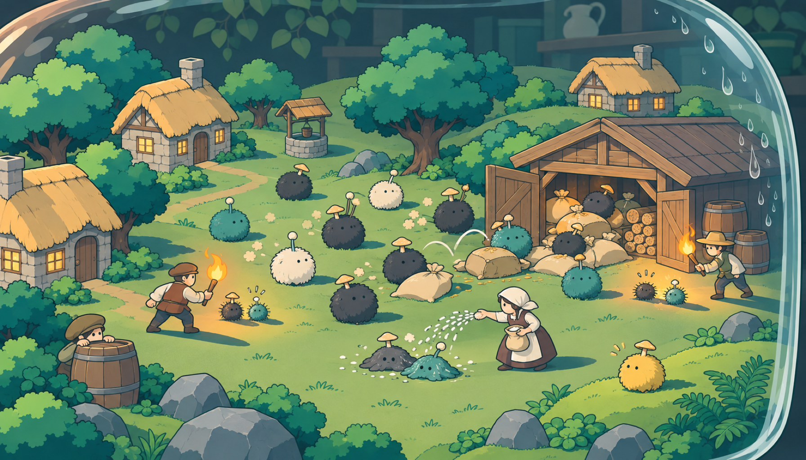
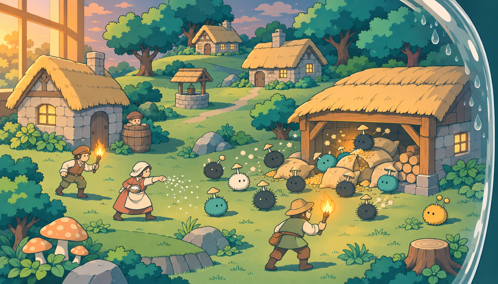
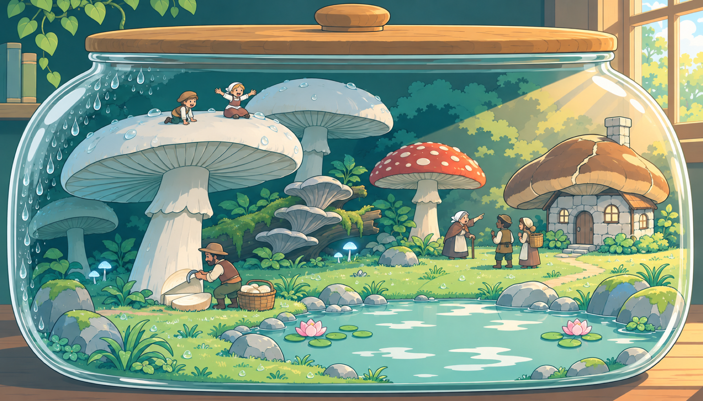
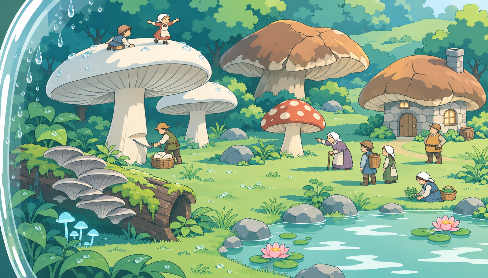
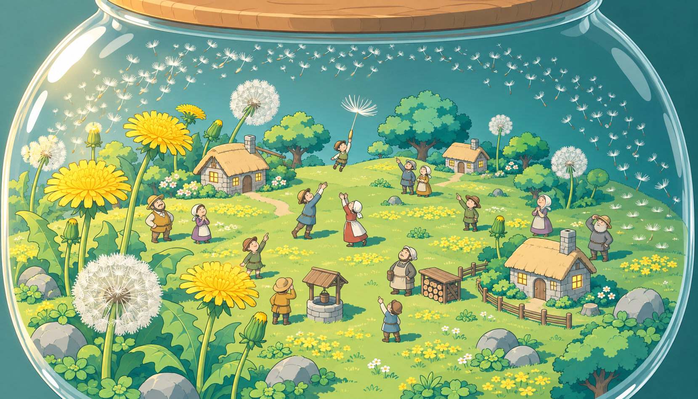
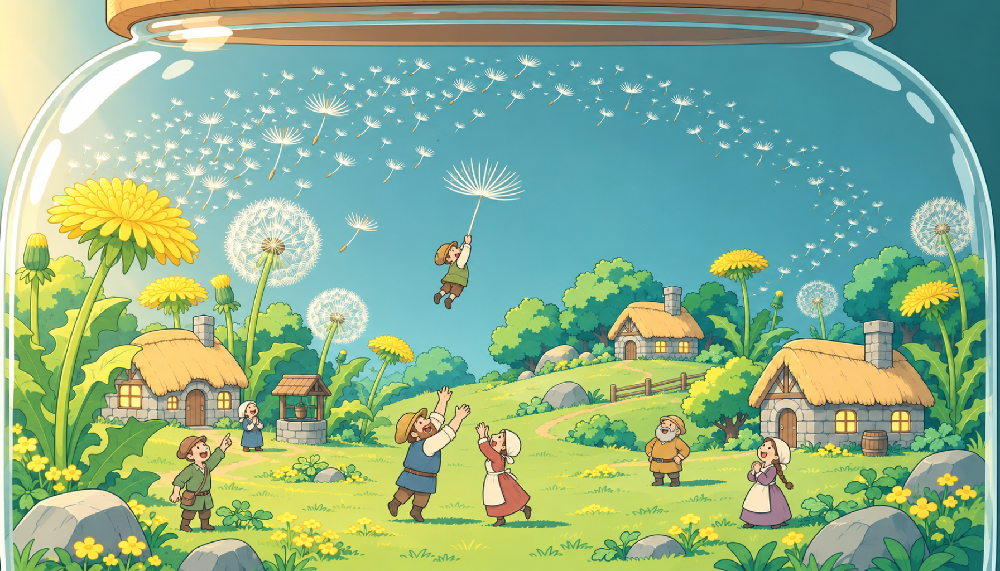
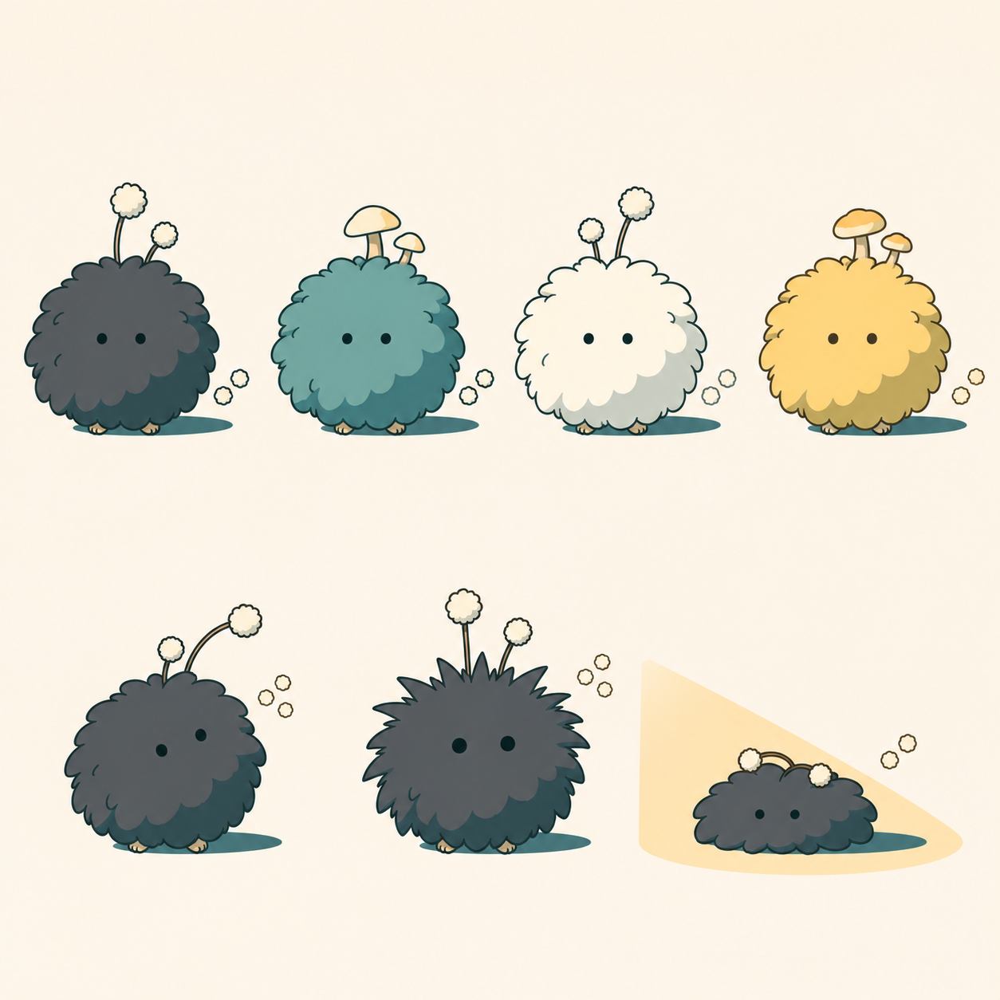

# 작은 세계 콘셉트 (WORLD_EVENTS 2.1 · 2.6 · 2.7)

codex-cli 0.163.0 내장 이미지 생성, 스타일 참조 `style-test/flat2_map_a.png`, `flat2_map_b.png`, `1-1.png`. 기록은 `log.csv`.

| 장면 | 고른 것 | 다른 안 |
|---|---|---|
| 곰팡이 무리 습격 (2.1) |  |  |
| 큰 버섯 (2.6) |  |  |
| 큰 민들레 꽃씨 (2.7) |  |  |
| 곰팡이 설정화 |  | |

## 남은 문제
- mold_swarm_b: 황혼 느낌이 약하고(어두운 저녁), 창가 방향이 잘 안 보임.
- giant_mushrooms_b: 호수 위 뚜껑 물방울이 안 그려짐 (물길 규칙상 호수는 돌기 물방울 아래).
- dandelion_seeds_b: 1659x948로 나옴, 아이를 잡으려는 어른 동작이 약함 (a안이 더 분명).
