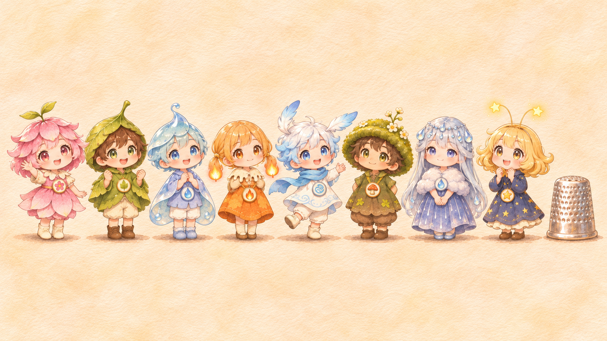

# 정령 8명: 라인업 시안 (2026-11-16)

그림체는 사용자가 고른 **B(과슈·수채 그림책)**로 그렸다. `codex exec`의 내장 이미지 생성으로 만들었고, `style_test/B_card.png`와 `style_test/B_shelf.png`를 참조 그림(`-i`)으로 넣었다. 그림체 문장은 `style_test/prompts.md`의 B 문장을 그대로 썼다. 프롬프트 원문은 [prompts.md](prompts.md)에 있다. 정령 목록은 `docs/gdd/G7-드랍-확률-획득-조건.md`에서 가져왔다.
생성 수는 **3 / 4**이다.

| 파일 | 내용 | 크기 |
|---|---|---|
| [lineup_b.png](lineup_b.png) **← 가장 좋음** | 8명 한 줄 + 골무. a를 고친 판 | 1672×941 |
| [lineup_a.png](lineup_a.png) | 8명 한 줄 + 골무. 첫 판 | 1672×941 |
| [lineup_rare.png](lineup_rare.png) | 희귀 둘(비·별)을 크게 그린 짝 그림 | 1536×1024 |

## 어느 것이 가장 좋은가

**lineup_b.** a와 디자인·순서·배경은 같다. 다만 a에서 눈을 감고 웃던 셋(잎새, 촛불, 이끼)이 b에서는 눈을 떴다. 그래서 8명 모두 눈 색과 눈 모양을 비교할 수 있다. 촛불 정령의 불꽃도 a에서는 양 갈래 머리 옆에 떠 있었는데, b에서는 머리끝에 붙었다. 골무도 a보다 조금 커져 정령 키에 가까워졌다.
a는 눈 감고 웃는 표정이 귀여워서 표정 참고용으로 남겨 둔다.

## 정령별 디자인 메모 (왼쪽부터)

1. **꽃잎 (petal, 여)**: 분홍 꽃잎 단발과 머리 위 새싹, 꽃잎 치마. B_card의 아이와 같은 얼굴과 머리여서 일관성이 가장 좋다.
2. **잎새 (leaf, 남)**: 꼭지가 달린 큰 잎사귀 두건, 갈색 머리, 이끼색 판초. B_shelf의 그네 타던 아이와 같다.
3. **물방울 (drop, 남)**: 물방울 끝이 말린 하늘색 머리, 투명한 물방울 망토. 망토가 비쳐 보여 '물'이 바로 읽힌다.
4. **촛불 (ember, 여)**: 꿀색 양 갈래 머리 끝에 작은 촛불이 붙어 있다. 촛농 모양 깃, 주황 앞치마 원피스. 졸린 듯 순한 얼굴이라 위험해 보이지 않는다.
5. **산들 (breeze, 남)**: 흰 머리 끝이 하늘색이고 옆머리에 깃털 귀가 달렸다. 하늘색 목도리가 날린다. 혼자 한 발을 들고 있어 가장 가벼워 보인다.
6. **이끼 (moss, 남)**: 넓고 둥근 이끼 모자에 작은 흰 꽃이 피었다. 피부가 조금 더 짙고, 체형이 통통하다. 모자 실루엣이 가장 넓어서 줄에서 바로 구분된다.
7. **비 (rain, 희귀, 여)**: 은청색 긴 생머리에 빗방울 왕관(머리띠처럼 얹힘, 헤일로 아님), 구름 숄, 빗줄기 무늬 원피스. 다른 정령보다 장식이 섬세하지만 키는 같다.
8. **별 (star, 희귀, 여)**: 레몬색 곱슬머리, 끝에 금빛 별이 달린 더듬이, 별 무늬 남색 밤하늘 원피스. B_shelf의 별 정령과 같은 아이다 (그때는 코트, 이번에는 원피스).

모두 가슴에 원형 배지(꽃·잎·물방울·불꽃·바람 소용돌이·버섯·빗방울·별)를 달아 원소를 표시했다. 여자 넷, 남자 넷이다. 실루엣(둥근 꽃잎 / 뾰족한 잎 / 물방울 / 양 갈래 불꽃 / 옆 깃털 / 넓은 모자 / 긴 머리 / 더듬이)과 대표 색이 모두 다르다. 키와 체형이 같아서 겉모습이 능력 차이로 읽히지 않는다.

## 문제·확인할 것

- **크기:** 두 라인업 모두 골무가 정령보다 조금 작다 (b에서 정령 키의 약 3/4). 기획대로 '정령 키 ≈ 골무'라면 정령을 조금 줄여야 한다. 게임 화면에서는 엔진이 크기를 정하므로 큰 문제는 아니다.
- **빈 여백:** 8명과 골무를 한 줄에 세우느라 인물이 그림 높이의 약 40%만 차지한다. 위아래 종이가 많이 남는다. 발표용으로 쓸 때는 가운데 띠만 잘라 쓰면 된다 (원본은 자르지 않았다).
- **희귀 짝 그림(lineup_rare):** 분위기와 얼굴은 셋 중 가장 예쁘다. 비 오는 창과 별이 뜬 창이 반씩 나뉘고, 리본 해먹과 병뚜껑 수영장이 들어갔다. 다만 정령이 머그만큼 커서 '손가락만 한' 크기가 아니라 인형 크기다 (style_test의 보상 카드들과 같은 문제). 비 정령은 라인업보다 머리 비율이 조금 작아 약 3등신에 가깝다.
- **희귀 표시:** 비·별은 장식과 은은한 빛으로만 특별함을 냈다. 크기나 자세로 강해 보이게 하지는 않았다. 더 특별해 보여야 하면 바탕(카드 테두리, 빛 효과)은 UI에서 정하는 편이 낫다.
- **기존 캐릭터와 닮은 점:** 특정 작품의 캐릭터를 떠올리게 하는 디자인은 눈에 띄지 않았다. 글자, 로고, 헤일로, 무기, 고양이, 교복도 없다. 손가락이 틀리거나 눈이 일그러진 곳도 없다.
- **이름:** 메모에 쓴 한글 이름(꽃잎·잎새·물방울·촛불·산들·이끼·비·별)은 설명용 임시 이름이다. 정식 이름은 정하지 않았다.
