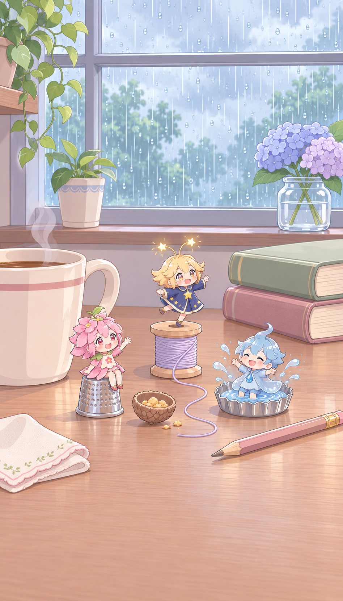
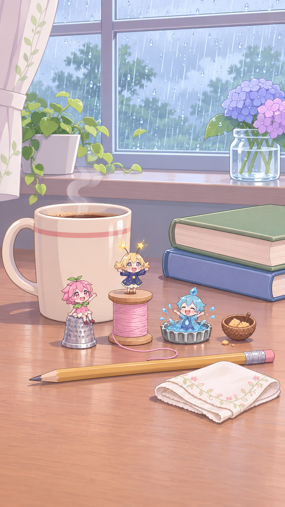
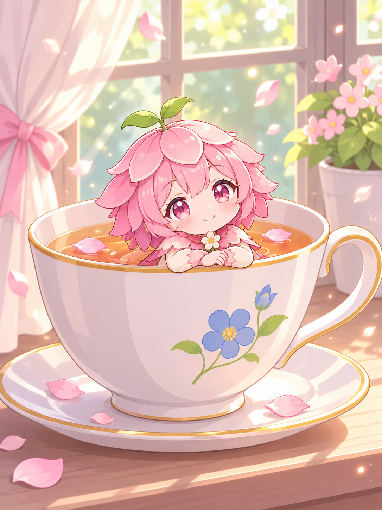
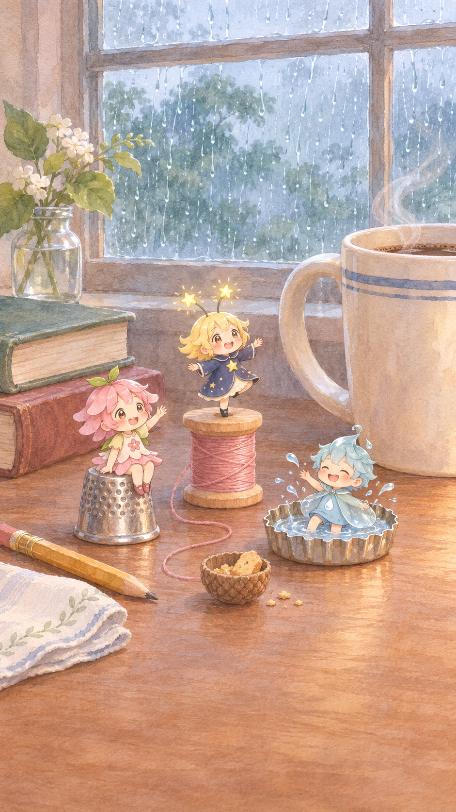
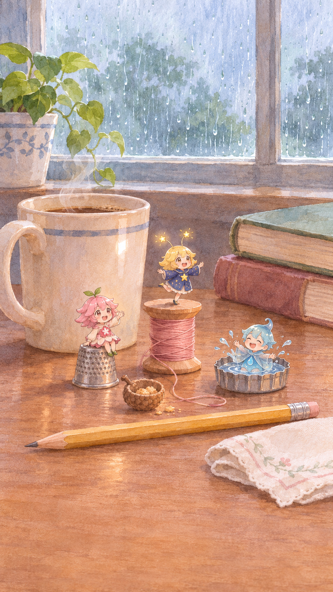
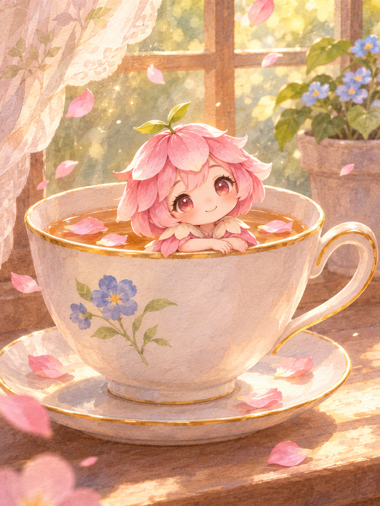
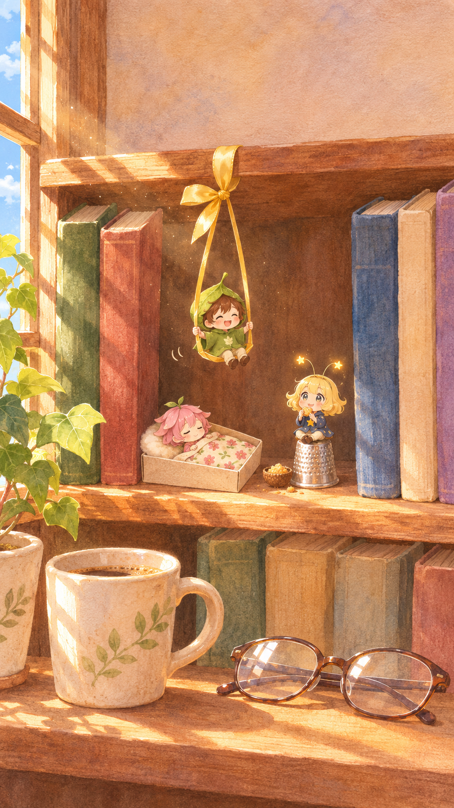
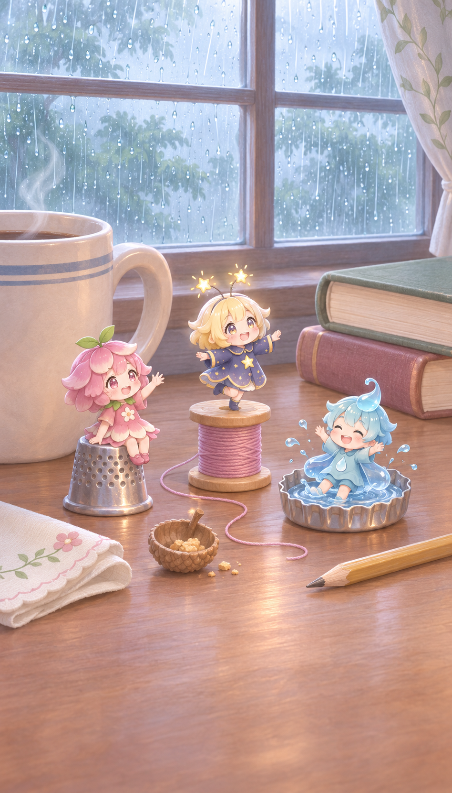
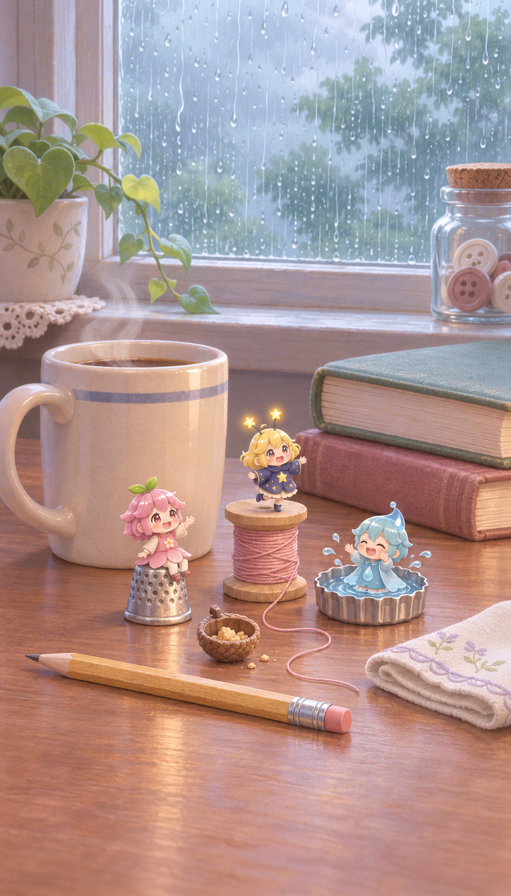
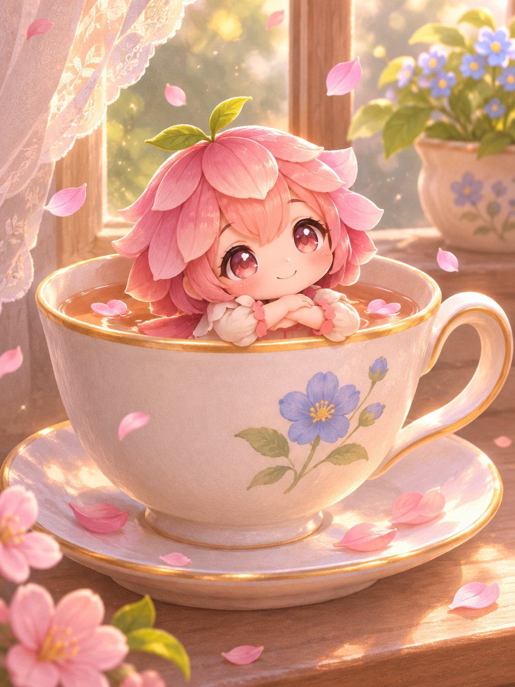

# 정령의 집: 그림체 시험 (2026-11-16)

이 시험은 새 콘셉트의 그림체를 고르기 위한 것이다. 무대는 사람 크기 방이고, 손가락만 한 SD 정령이 찾아온다. 방향은 세 가지(A, B, C)이고 방향마다 방 장면(9:16)과 보상 카드(3:4)를 그렸다.
그림은 모두 `codex exec`의 내장 이미지 생성으로 만들었다 (참조 이미지 없음). 프롬프트 원문은 [prompts.md](prompts.md), 기록은 [log.csv](log.csv)에 있다. 생성 수는 **10 / 12**이다.

| 방향 | 방 1차 | 방 2차 (크기 수정) | 보상 카드 | 추가 |
|---|---|---|---|---|
| **A** 셀 채색, 파스텔 |  |  |  | |
| **B** 과슈·수채 그림책 |  |  |  |  맑은 아침 책장 (리본 그네, 성냥갑 침대, 나뭇잎 정령) |
| **C** 말랑한 장난감 질감 |  |  |  | |

## 방향별 메모

### A: 깔끔한 셀 채색, 파스텔
- **좋은 점:** 얼굴과 윤곽이 가장 또렷하다. 폰에서 작게 보여도 표정이 읽힌다. 밝은 단색 면이라 둥근 카드나 반투명 UI와 잘 어울린다. 움직이는 그림(스프라이트, 애니메이션)으로 옮기기도 가장 쉽다. 크기를 줄여 다시 그리라고 했을 때 가장 잘 따랐다 (2차: 머그 높이의 약 0.3).
- **아쉬운 점:** 방이 평평하게 그려져서 '진짜 사람 크기 방'이라는 무게감이 약하다. 정령이 책상 위에 붙인 스티커처럼 떠 보인다. 흔한 애니 배경 느낌이라 우리만의 개성은 덜하다.

### B: 과슈·수채 그림책
- **좋은 점:** 가장 포근하고, '일러가 예뻐야 한다'는 기준에 가장 가깝다. 머그, 책, 나뭇결에 질감이 있어 사람 크기 물건이 진짜처럼 묵직해 보인다. 그 앞에 선 매끈한 SD 얼굴과 대비가 잘 난다. 비 오는 오후(방)와 맑은 아침(책장)에서 모두 분위기가 살았다. **책장 추가 그림(B_shelf)은 크기 대비가 전체에서 가장 좋다.** 정령이 책 높이의 약 1/5이고, 안경알이 정령 하나보다 넓다. 위쪽 벽에는 UI 자리도 남았다.
- **아쉬운 점:** 종이 결이 정령 몸에도 묻어서 아주 작게 보면 A보다 덜 또렷하다. 장마다 붓 느낌이 조금씩 다르므로 대량으로 만들려면 기준 그림을 참조(`-i`)로 넣어 그림체를 묶어야 한다. 방 장면은 크기를 줄여 다시 그려도 거의 변하지 않았다 (머그의 약 0.35).

### C: 말랑한 장난감 질감
- **좋은 점:** 빛과 광택이 가장 화려해서 고급스러워 보인다. 카드(C_card)는 피규어 같은 귀여움이 강하다.
- **아쉬운 점:** '2D 그림'으로 그리라고 했지만 3D 렌더나 피규어 사진처럼 나왔다 (**그림체 이탈**). 정령이 살아 있는 손님보다 진열된 인형처럼 보인다. 셋 중 크기가 가장 크게 나왔고, 다시 그려도 줄지 않았다 (머그의 약 0.4). 게임 안에서 이 질감 그대로 움직이게 하려면 3D 제작이 필요해 범위가 커진다.

## 공통으로 확인한 것
- **크기 비율:** 기획(D8 필러 3)은 '정령 키 ≤ 머그 높이의 1/5'이다. 하지만 이미지 모델은 얼굴을 보여 주려고 정령을 머그의 1/3 안팎으로 그린다. 크기를 cm로 적어 다시 그렸더니 A만 조금 줄었다. 대신 정령보다 훨씬 큰 물건(책장, 안경)을 크게 보여 주는 구도(B_shelf)가 작은 느낌을 가장 잘 냈다. 1/5을 엄격히 지키면 정령이 화면 높이의 약 5%가 되어 얼굴이 아주 작아진다. 그래서 다음 두 가지를 아트 바이블에서 정해야 한다.
  - 게임 화면에서는 엔진이 배치를 정하므로 1/5을 지킨다.
  - 보상 일러스트는 '1/4~1/3까지 허용하고, 대신 사람 크기 물건을 크게 보이게 한다'로 할지 정한다.
- **보상 카드:** 세 장 모두 정령이 찻잔에 비해 인형만 하다 (머리가 찻잔 폭의 약 1/3). 손가락 크기라면 1/10쯤이어야 한다. 카드는 인물 중심 그림이라 남겨 두었다.
- **위·아래 UI 자리:** 아래쪽 책상 면은 대부분 비어 있다. 위쪽은 비 오는 창이라 UI 뒤 배경으로 쓸 만하다.
- **얼굴:** 10장 모두 얼굴이 깨끗하고, 눈이 일그러지거나 손가락 수가 틀린 곳은 눈에 띄지 않았다. 글자, 로고, 헤일로, 무기, 고양이도 없다.

## 추천
**B(그림책)를 기본으로 하고, 정령 얼굴과 선만 A처럼 또렷하게 그리는 방향**을 추천한다. B_room_v2와 B_shelf가 이미 그 중간에 가깝다. 2순위는 A다. 만들기 쉽고 작은 화면에서 가장 잘 읽힌다. C는 3D로 갈 때만 다시 볼 만하다.
