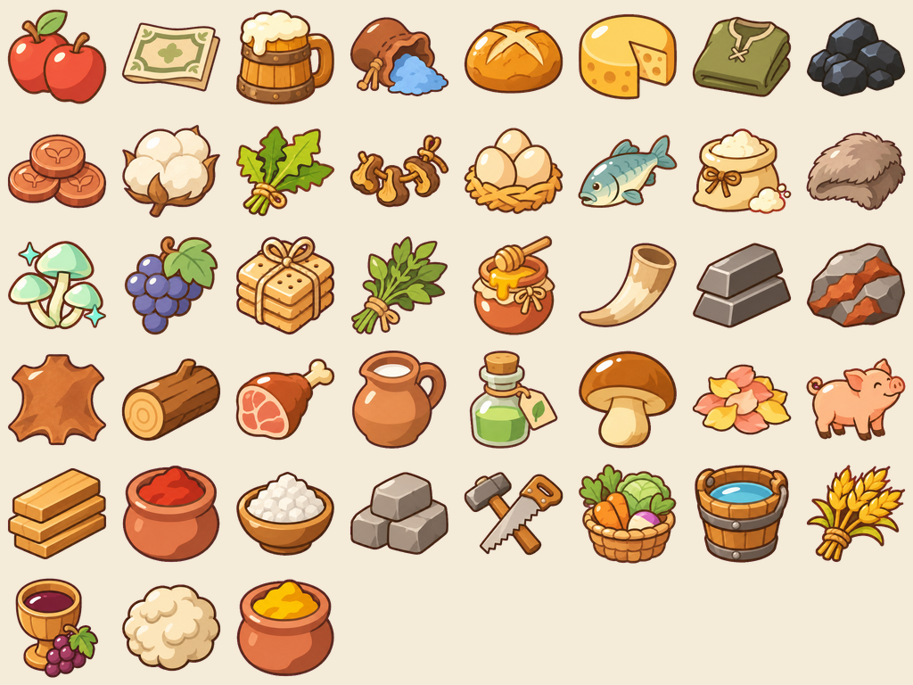
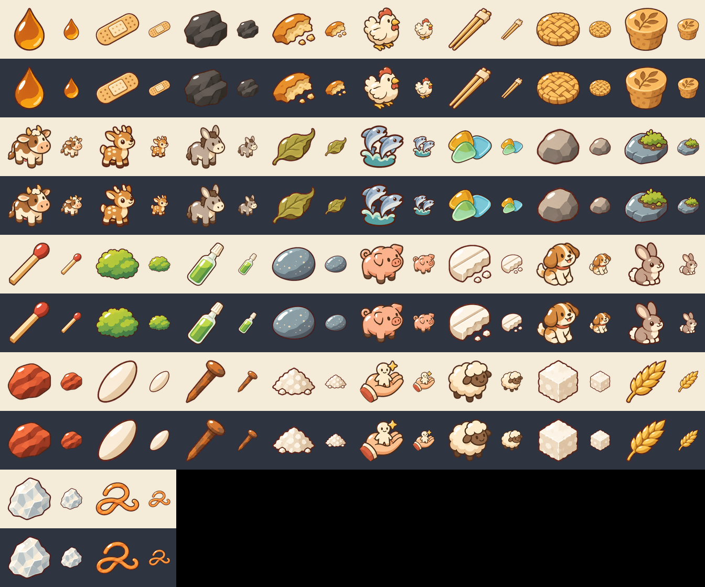
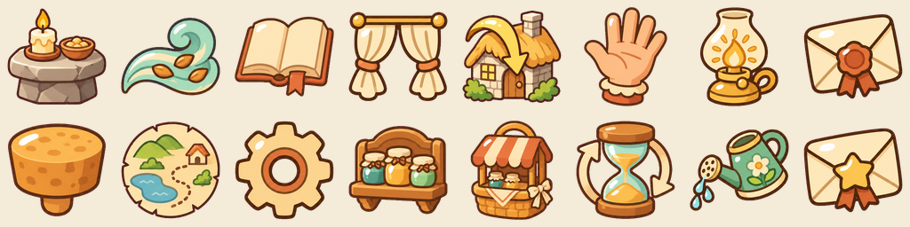
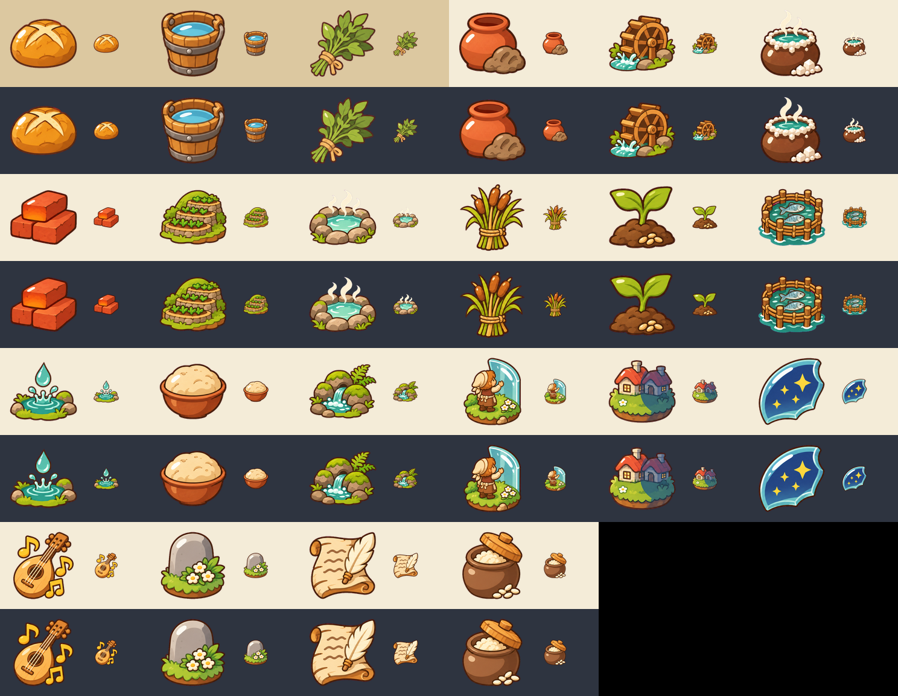

# 아이콘 세트 v1 (ROADMAP A8)

물건·상점 물건·UI 도구 아이콘 93장. 256×256 투명 PNG → `godot/art/icons/<group>/<id>.png`.
코드는 `godot/art/icons/icons.json` (한국어 이름 → `res://` 경로, 별칭 포함)을 쓴다.

- 생성: `codex exec` 내장 이미지 생성, 1536×1024 시트(4×3 / 4×2)에 평평한 마젠타 배경 → `tools/slice.py`로 키잉·잘라내기 (가장자리 픽셀은 가장 가까운 불투명 색으로 채워 마젠타 테두리 없음).
- 다시 만들기: `tools/gen.sh <sheet_id> <tag>` → `tools/slice.py sheets/<sheet>.png <sheet_id>`. 시트 목록·프롬프트는 `tools/sheets.json`. 미리보기: `tools/preview.py`.
- 스타일 참조: `design/icon/L_2.png`. 기록: `log.csv`.

| 묶음 | 수 | 경로 |
|---|---|---|
| 물건 (goods) | 43 | `godot/art/icons/goods/` |
| 상점 물건 (shop) | 34 | `godot/art/icons/shop/` |
| UI 도구 (ui) | 16 | `godot/art/icons/ui/` |

## 물건 (주민 크기)

크기 비교 256 / 96 / 48 (밝은·어두운 바탕): [`contact/goods_sizes.png`](contact/goods_sizes.png)

| 이름 | 파일 | 시트 |
|---|---|---|
| 가죽 | `goods/leather.png` | goods_3 |
| 건량 | `goods/hardtack.png` | reroll_1 |
| 고기 | `goods/meat.png` | goods_1 |
| 곰팡이약 | `goods/mold_cure.png` | goods_3 |
| 꽃잎 | `goods/petals.png` | goods_2 |
| 꿀 | `goods/honey.png` | goods_4 |
| 노란 물감 | `goods/yellow_dye.png` | goods_3 |
| 달걀 | `goods/egg.png` | goods_4 |
| 도구 | `goods/tools.png` | goods_2 |
| 돌 | `goods/stone.png` | goods_2 |
| 돼지 | `goods/pig.png` | goods_1 |
| 말린 버섯 | `goods/dried_mushroom.png` | goods_1 |
| 맥주 | `goods/beer.png` | goods_1 |
| 물 | `goods/water.png` | goods_2 |
| 민들레 잎 | `goods/dandelion_leaf.png` | goods_1 |
| 밀 | `goods/wheat.png` | goods_1 |
| 밀가루 | `goods/flour.png` | goods_1 |
| 버섯 | `goods/mushroom.png` | goods_1 |
| 붉은 물감 | `goods/red_dye.png` | goods_3 |
| 빛버섯 | `goods/glow_mushroom.png` | goods_1 |
| 빵 | `goods/bread.png` | goods_1 |
| 뿔 | `goods/horn.png` | goods_3 |
| 사과 | `goods/apple.png` | goods_4 |
| 생선 | `goods/fish.png` | goods_1 |
| 석탄 | `goods/coal.png` | goods_2 |
| 소금 | `goods/salt.png` | goods_2 |
| 솜 | `goods/cotton.png` | goods_3 |
| 약초 | `goods/herb.png` | goods_3 |
| 양털 | `goods/wool.png` | goods_2 |
| 옷 | `goods/clothes.png` | goods_2 |
| 우유 | `goods/milk.png` | goods_3 |
| 주화 | `goods/coin.png` | goods_3 |
| 지폐 | `goods/banknote.png` | goods_3 |
| 채소 | `goods/vegetables.png` | goods_4 |
| 철 | `goods/iron.png` | goods_2 |
| 철광석 | `goods/iron_ore.png` | goods_2 |
| 치즈 | `goods/cheese.png` | goods_4 |
| 털 | `goods/fur.png` | goods_3 |
| 통나무 | `goods/log.png` | goods_2 |
| 판자 | `goods/plank.png` | goods_2 |
| 포도 | `goods/grapes.png` | goods_4 |
| 포도주 | `goods/wine.png` | reroll_1 |
| 푸른 가루 | `goods/blue_powder.png` | goods_3 |

## 거인의 상점 물건

크기 비교 256 / 96 / 48 (밝은·어두운 바탕): [`contact/shop_sizes.png`](contact/shop_sizes.png)

| 이름 | 파일 | 시트 |
|---|---|---|
| 각설탕 | `shop/sugar_cube.png` | shop_1 |
| 검은 돌 | `shop/black_stone.png` | shop_2 |
| 나무젓가락 | `shop/chopsticks.png` | shop_1 |
| 녹슨 못 | `shop/rusty_nail.png` | shop_1 |
| 마른 약초 한 잎 | `shop/dried_herb_leaf.png` | shop_1 |
| 밀 이삭 한 줄기 | `shop/wheat_ear.png` | shop_1 |
| 반창고 조각 | `shop/bandage.png` | shop_1 |
| 병 받침 | `shop/jar_stand.png` (Q37 — 옛 `coaster.png`는 파이처럼 보여 안 씀) | shop_6 |
| 호박빛 유리 · 물빛 유리 · 이끼빛 유리 · 안개빛 유리 | `shop/tint_amber.png` · `tint_sea.png` · `tint_moss.png` · `tint_mist.png` (Q37) | shop_6 |
| 삼끈 코르크 · 밀랍 코르크 · 불도장 코르크 | `shop/cork_twine.png` · `cork_wax.png` · `cork_brand.png` (Q37) | shop_6 |
| 붉은 돌멩이 | `shop/red_stone.png` | shop_2 |
| 빵 부스러기 | `shop/bread_crumb.png` | shop_1 |
| 성냥개비 | `shop/matchstick.png` | shop_2 |
| 소금 한 꼬집 | `shop/salt_pinch.png` | shop_1 |
| 소독약 한 방울 | `shop/antiseptic_drop.png` | shop_1 |
| 쌀 한 톨 | `shop/rice_grain.png` | shop_1 |
| 알약 부스러기 | `shop/pill_crumb.png` | shop_1 |
| 영양제 앰플 | `shop/nutrient_ampoule.png` | shop_2 |
| 유리 빛깔 | `shop/glass_tint.png` | shop_2 |
| 이끼 한 줌 | `shop/moss.png` | shop_2 |
| 이주민 뽑기 | `shop/settler_draw.png` | shop_3 |
| 자갈 한 알 | `shop/gravel.png` | shop_1 |
| 작은 강아지 | `shop/puppy.png` | shop_3 |
| 작은 물고기 한 줌 | `shop/fish_handful.png` | shop_5 |
| 작은 닭 | `shop/chicken.png` | shop_3 |
| 작은 당나귀 | `shop/donkey.png` | shop_3 |
| 작은 돼지 | `shop/piglet.png` | shop_3 |
| 작은 사슴 한 쌍 | `shop/deer.png` | shop_5 |
| 작은 소 | `shop/cow.png` | shop_3 |
| 작은 양 | `shop/sheep.png` | shop_3 |
| 작은 토끼 한 쌍 | `shop/rabbit.png` | shop_5 |
| 조약돌 | `shop/pebble.png` | reroll_1 |
| 코르크 무늬 | `shop/cork_pattern.png` | shop_2 |
| 털실 한 가닥 | `shop/yarn.png` | shop_2 |
| 하얀 돌 | `shop/white_stone.png` | reroll_1 |
| 회색 돌멩이 | `shop/grey_stone.png` | reroll_1 |

## UI 도구

크기 비교 256 / 96 / 48 (밝은·어두운 바탕): [`contact/ui_sizes.png`](contact/ui_sizes.png)

| 이름 | 파일 | 시트 |
|---|---|---|
| 뚜껑 | `ui/lid.png` | ui_1 |
| 마을로 가기 | `ui/go_village.png` | reroll_1 |
| 물뿌리개 | `ui/watering_can.png` | ui_2 |
| 불기 | `ui/blow.png` | ui_1 |
| 상점 | `ui/shop.png` | ui_1 |
| 선반 | `ui/shelf.png` | ui_1 |
| 소원 | `ui/wish.png` | ui_2 |
| 속도 | `ui/speed.png` | ui_1 |
| 손 | `ui/hand.png` | ui_1 |
| 연대기 | `ui/chronicle.png` | ui_1 |
| 제단 | `ui/altar.png` | reroll_1 |
| 지도 | `ui/map.png` | reroll_1 |
| 커튼 | `ui/curtain.png` | ui_2 |
| 톱니 | `ui/settings.png` | ui_2 |
| 편지 | `ui/letter.png` | ui_2 |
| 해/등불 | `ui/lamp.png` | ui_2 |

## 자체 점검

- 48px: 모든 아이콘이 실루엣으로 구분됨. 비슷한 것끼리(자갈 / 회색 돌멩이, 조약돌 / 쌀 한 톨, 하얀 돌 / 각설탕, 건량 / 밀가루, 포도주 / 우유, 제단, 지도, 마을로 가기)는 다시 뽑아 바꿈.
- 글자 없음. 주화는 새싹 무늬, 지폐는 무늬만.
- 선·빛: 짙은 갈색 얇은 선, 왼쪽 위 빛, 그늘 한 단계. 동물 6종 + 이주민 뽑기(shop_3)는 선이 조금 굵어 스티커 느낌 — 피규어 물건이라 허용.
- 투명: 90장 모두 가장자리에 마젠타 기 픽셀 없음(자동 검사), 캔버스 테두리에 닿는 픽셀 없음.
- 겹치는 모양: 소금(그릇)과 소금 한 꼬집, 석탄과 검은 돌, 버섯과 상점 물건은 일부러 비슷한 계열.

## 발견 도감 (disc) — ROADMAP B4

`Codex.ENTRIES`의 `art` 이름 그대로 icons.json 키 (`disc_clay` …). 생성: `tools/gen_ref.sh <sheet> <tag>` (L_2 + 기존 아이콘 3장 `tools/ref_disc_goods.png` 참조).

| 키 | 파일 | 시트 |
|---|---|---|
| `disc_clay` | `disc/clay.png` | disc_1 |
| `disc_waterwheel` | `disc/waterwheel.png` | disc_1 |
| `disc_brine` | `disc/brine.png` | disc_1 |
| `disc_brick` | `disc/brick.png` | disc_1 |
| `disc_terrace` | `disc/terrace.png` | disc_1 |
| `disc_hot_spring` | `disc/hot_spring.png` | disc_1 |
| `disc_reed` | `disc/reed.png` | disc_1 |
| `disc_sapling` | `disc/sapling.png` | disc_1 |
| `disc_fish_pen` | `disc/fish_pen.png` | disc_1 |
| `disc_drip_place` | `disc/drip_place.png` | disc_1 |
| `disc_risen_bread` | `disc/risen_bread.png` | disc_1 |
| `disc_world_spring` | `disc/world_spring.png` | disc_1 |
| `disc_world_end` | `disc/world_end.png` | disc_2 |
| `disc_giant_shadow` | `disc/giant_shadow.png` | disc_3 |
| `disc_stars` | `disc/stars.png` | disc_2 |
| `disc_song` | `disc/song.png` | disc_2 |
| `disc_funeral` | `disc/funeral.png` | disc_2 |
| `disc_writing` | `disc/writing.png` | disc_2 |
| `disc_koji` | `disc/koji.png` | disc_2 |
