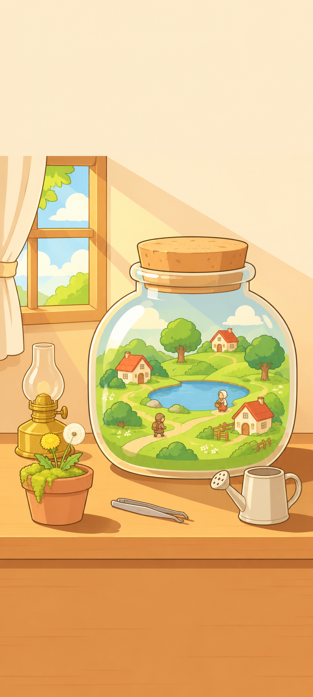
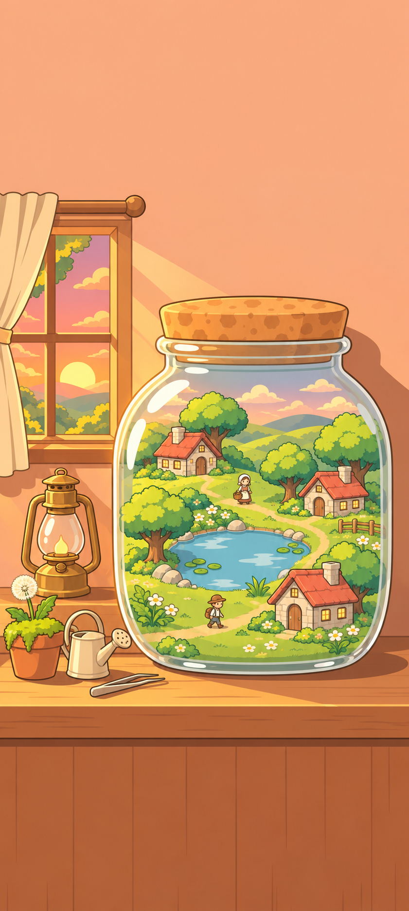
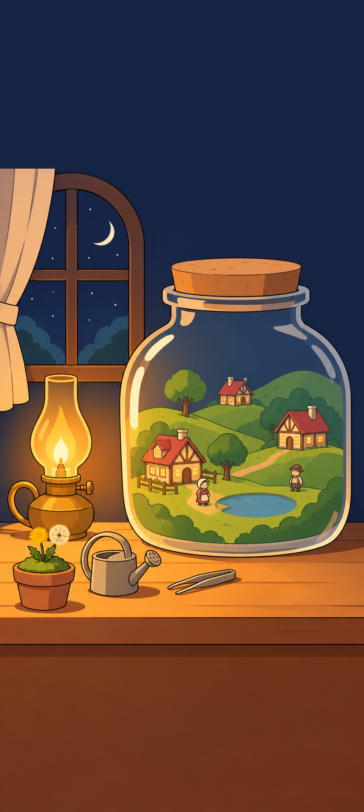
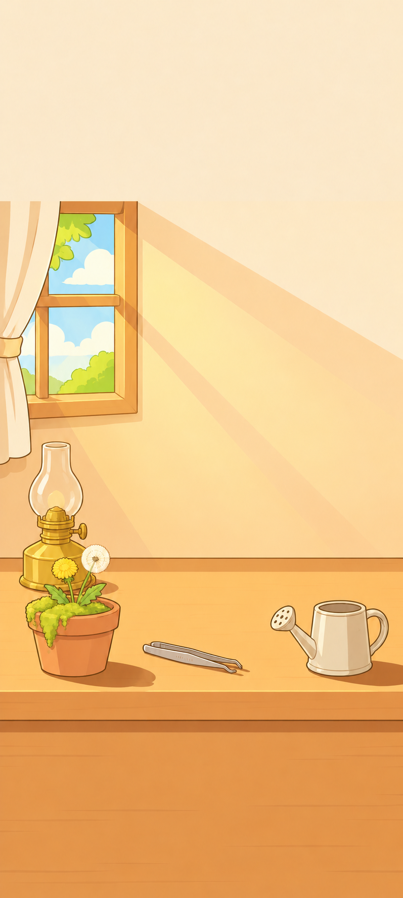
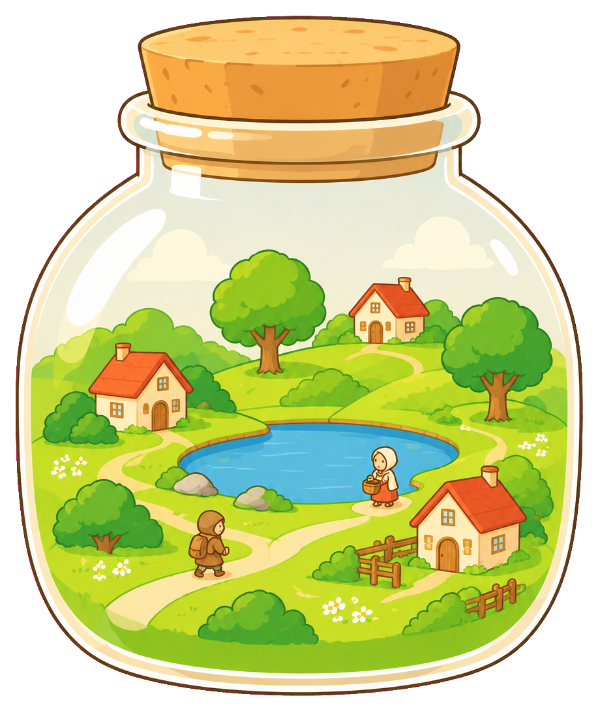
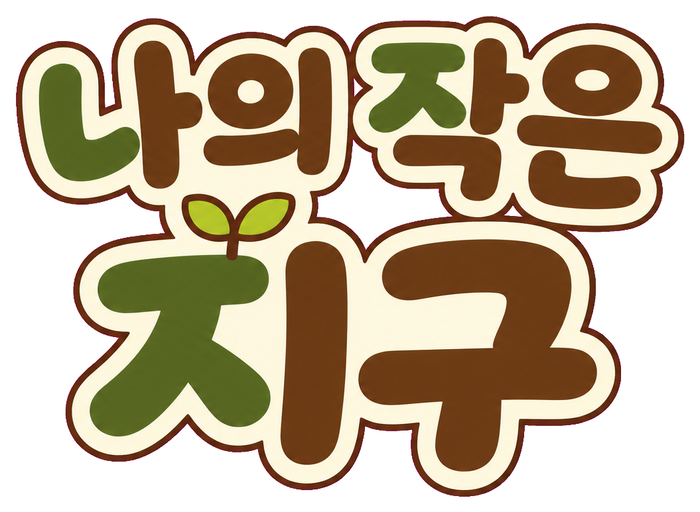
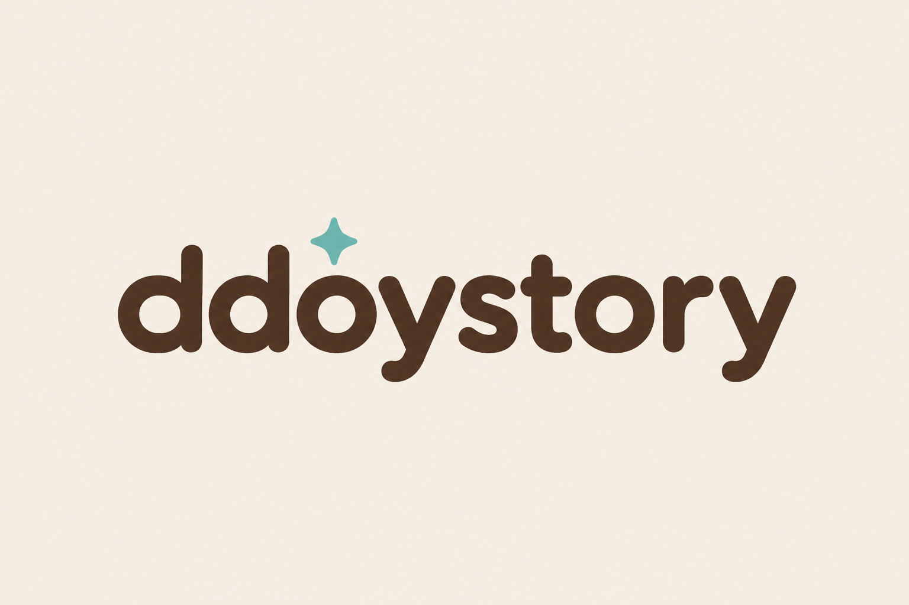
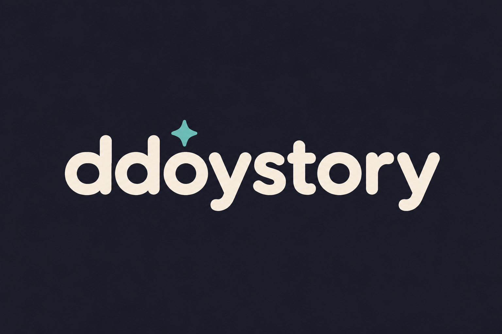

# 타이틀 화면 그림 (UI 00 시작 흐름)

모델: codex-cli 0.163.0 내장 이미지 생성. 스타일 참조: `design/icon/L_2.png`, `design/concept/style-test/flat2_map_a.png`, `design/concept/1-1.png`. 기록은 [log.csv](log.csv).

| 자리 | 추천 원본 | Godot 파일 (`godot/art/title/`) | 미리보기 |
|---|---|---|---|
| 타이틀 배경 — 아침 | `bg_a1.png` | `title_bg_morning.png` (1080×2400) |  |
| 타이틀 배경 — 노을 | `bg_b1.png` | `title_bg_sunset.png` (1080×2400) |  |
| 타이틀 배경 — 밤 | `bg_c1.png` | `title_bg_night.png` (1080×2400) |  |
| 방 (병 없음, 아침) | `room_a1.png` | `room.png` (1080×2400) |  |
| 병 (투명 배경) | `jar_a1.png` → `jar_a1_alpha.png` | `jar.png` (917×1089, 알파) |  |
| 제목 로고 | `logo_title_1.png` → `logo_title_1_alpha.png` | `logo_title.png` (1055×773, 알파) |  |
| 회사 로고 (밝은 바탕용) | `logo_company_1.png` → `_alpha` | `logo_company.png` (1196×326, 알파) |  |
| 회사 로고 (어두운 바탕용) | `logo_company_dark_1.png` → `_alpha` | `logo_company_dark.png` (1195×328, 알파) |  |

## 메모
- 배경 원본은 841×1870 (생성기 최대 세로 비율). Godot 파일은 Lanczos로 1080×2400까지 키움 (약 1.28배).
- 병의 위치 (아침 배경 1080×2400 기준, 대략): x 305~1030, y 820~1650. `room.png` 위에 `jar.png`를 그 자리 폭(약 725px)으로 놓으면 맞음 — 병은 원본에서 다시 그린 것이라 픽셀 단위로 똑같지는 않다.
- 병·제목 로고는 초록 대신 **마젠타(#FF00FF)** 바탕으로 뽑아 알파로 뺐다 (병 안 풀밭·로고 초록 글자가 초록 키에 지워지기 때문). 병 유리는 불투명하게 그려져 뒤가 비치지 않는다.
- 제목 로고 글자 확인: "나의 작은 지구" 6글자 모두 정확. 다만 '나의'와 '작은' 사이 띄어쓰기가 거의 없다. 병 모양 ㅇ을 넣은 시도(`rejected/logo_title_2.png`)는 의의 ㅡ가 빠져 '나이'로 읽혀 탈락.
- 노을(b)의 등불은 기름 등잔 대신 작은 초롱(촛불)으로 나옴. 밤(c)은 창이 아치형이라 a·b와 모양이 다름 — 시각별로 배경을 통째로 바꾸면 문제없고, 겹 애니메이션은 아침(a) 기준.
- 확인: 바다 없음(작은 호수만), 글자 없음(로고 제외), 빛은 왼쪽 위 창에서만, 위 ~22%·아래 ~20% 비어 있음.
